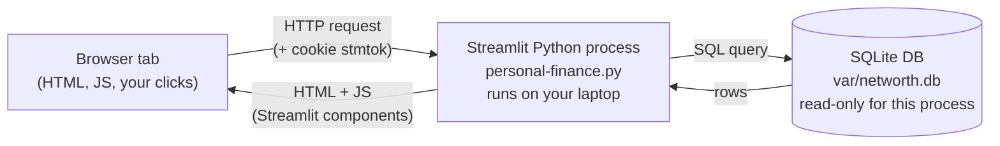
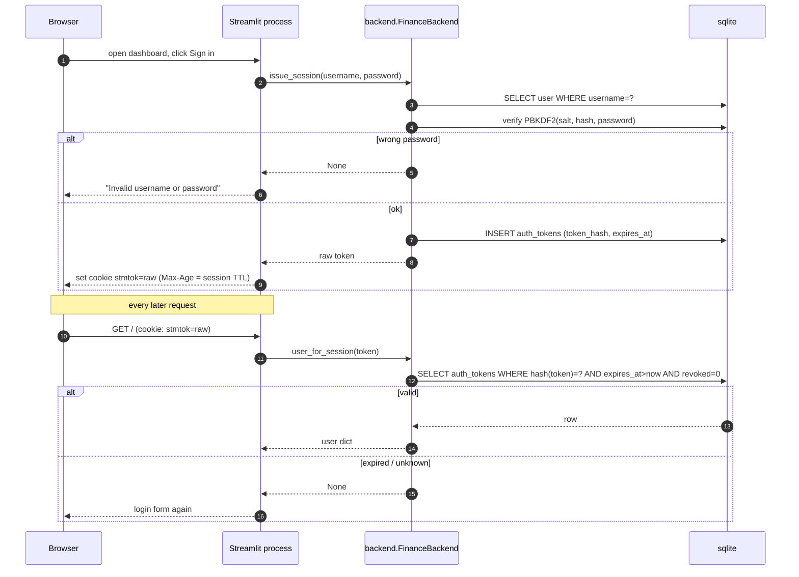
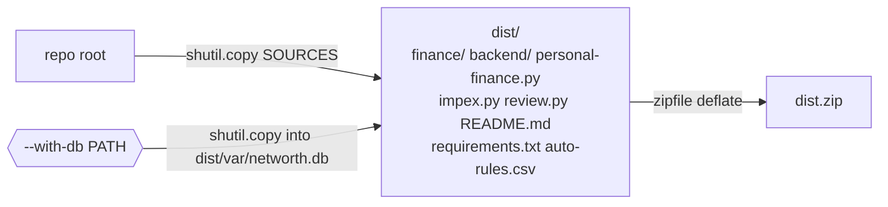

# Architecture diagrams — for someone new to Python and the web

This document is the **on-ramp** to the codebase. If you've never written a
web app before, never used a database, or are still getting comfortable with
Python packages and `import` statements — start here. The system itself is
small (one CLI + one web app + one sqlite file), and the goal of this doc is
to make it feel small.

> **A note on the web framework.** The dashboard uses **Streamlit**, not
> Flask. Both are Python web frameworks — you write Python, and a server
> turns your code into a web page in the browser. Streamlit is built
> specifically for data dashboards (forms, charts, tables) and is what this
> project uses; the request lifecycle in the diagrams below applies to
> Streamlit but is conceptually identical to Flask's.

## Mini-primer — read this first

**Python packages.** A *module* is one `.py` file. A *package* is a directory
of modules with an `__init__.py` file. You use one from another file with
`import` or `from … import …`:

```python
from finance.rules import RuleSet            # use RuleSet from finance/rules.py
from backend import FinanceBackend, UNKNOWN  # use the backend's facade
```

**A web app, in one sentence.** A long-running Python process waits for
browsers to send it requests; on each request, the process runs Python code,
talks to a database, and sends an interactive HTML page back. The page may
include a cookie that the browser stores, so the server can recognize the
same user on the next request ("a session").

**A database.** A single file on disk (here: `var/networth.db`) that holds
rows in named *tables* (think of a spreadsheet per table). You never edit it
by hand — your code reads and writes it through a *facade* (`FinanceBackend`)
so the SQL stays in one place.

**Configuration vs personal data.** The committed repository is generic — no
real bank data, no passwords, no rule files. Per-member data lives in
gitignored folders: `data/<member>/` (raw statements, your input),
`var/networth.db` (the database, derived from that input), `members.yaml`
(your members), and the rule files. Anyone with the same code can re-derive
their own database from their own statements.

---

## 1. System context — what pieces exist

This is the whole system on one whiteboard. The raw CSVs in `data/` are
yours to edit; the database in `var/` is built from them by `impex.py`; the
dashboard reads the database and renders an interactive page in your
browser.

```
                    your computer
   ┌────────────────────────────────────────────────────────────────────┐
   │                                                                    │
   │   data/mamta/bank-statements/2024-25/*.csv     raw bank exports     │
   │   data/mamta/investments/*.csv                holdings sheets      │
   │           │                                                          │
   │           │   impex.py import  (CLI, gated by password)              │
   │           ▼                                                          │
   │   ┌────────────────────────┐                                          │
   │   │   var/networth.db       │  ← the only thing that's "truth"        │
   │   │   (sqlite database)     │                                          │
   │   └──────────┬─────────────┘                                          │
   │              ▲ read   ▲ read                                          │
   │              │       │                                                │
   │       personal-finance.py       streamlit run, password login         │
   │              │                                                       │
   │   ┌──────────▼─────────────┐                                          │
   │   │  Streamlit Python      │  ──── HTTP ────▶  your browser tab       │
   │   │  process               │  ◀─── HTML+JS ───                        │
   │   └────────────────────────┘                                          │
   │                                                                       │
   └───────────────────────────────────────────────────────────────────────┘
```

**Read this as:** *raw CSVs are imported by `impex.py` into the database;
the dashboard reads the database; your browser talks to the dashboard over
HTTP.*

---

## 2. Web primer — "what happens when I open the dashboard"

You type `http://localhost:8501` into a browser tab. Three things live on
your machine and talk over HTTP:



**Step by step:**

1. The **browser** sends a request to your local Streamlit process over HTTP.
   If you have a session cookie (`stmtok`), it travels with every request.
2. The **Streamlit process** runs the dashboard's Python code from the top:
   it authenticates the cookie, queries the DB, builds the page widgets,
   draws charts, and decides what to render.
3. The **database** answers the SQL queries and sends rows back. The
   Streamlit process turns those rows into an HTML+JS page.
4. The **browser** receives the page, displays it, and prepares to send the
   next request (any click, any filter change — each one is a fresh request
   to the same Python process).

The whole app re-runs Python on every interaction. That's why Streamlit is
slower than a SPA but much simpler to write — there's no client-side router
or API to design; the Python code *is* the page.

The dashboard's "session state" (`st.session_state`) lives in the Python
process and survives between renders of the same user (until you close the
tab or click *Sign out*).

---

## 3. Code map — what's inside the repo

This is the directory tree, trimmed to the code that matters. Two packages
plus a handful of root scripts that are the user-facing entry points.

```
personal-finance/
├── finance/                  ← SHARED DOMAIN (imported by the dashboard and the CLI)
│   ├── common.py             shared helpers (members, money, FY, payee_key, "inr" ₹ formatter)
│   ├── rules.py              classification-rule language (Rule, RuleSet)
│   ├── holdings.py           investment sheet parser + XIRR math
│   ├── llm.py                OpenRouter client (used only by "auto" import mode)
│   └── classify.py           statement parser + reconciliation; used by impex
│
├── backend/                  ← PERSISTENCE (the system of record)
│   ├── schema.py             append-only versioned migrations (PRAGMA user_version)
│   ├── model.py              FinanceBackend facade (entries, investments, users)
│   ├── auth.py               PBKDF2 password hashing + opaque session tokens
│   ├── db.py, paths.py       tiny sqlite connection helpers + database location
│   └── __init__.py           re-exports FinanceBackend, UNKNOWN, db_path
│
├── personal-finance.py       ← ENTRY POINT: streamlit dashboard (the web app)
├── impex.py                  ← ENTRY POINT: CLI for import / export / backup / restore
├── review.py                 ← ENTRY POINT: helper CLI; prints rule suggestions
│
├── scripts/                  ← build / maintenance utilities
│   ├── make_dist.py          rebuilds dist/ + dist.zip
│   └── seed_auto_rules.py    one-time seeding of auto-rules.csv from rules.txt
│
├── tests/                    ← unittest suite (mirrors the layers)
│   ├── test_backend.py       backend/ behaviour (schema, entries, investments, auth)
│   ├── test_common.py        finance/common.py helpers
│   ├── test_rules.py         finance/rules.py grammar
│   ├── test_holdings.py      finance/holdings.py XIRR + parsers
│   ├── test_classifier.py    finance/classify.py parser / reconcile
│   ├── test_impex.py         impex.py CLI (import/export/backup/auth gate)
│   ├── test_app.py           dashboard widgets + edit-commit helpers (AppTest)
│   └── test_dashboard_values.py  value-level assertions over a clean two-member sample
│
├── specs/                    project contracts (committed)
├── diagrams.md               ← this file
└── README.md                 runbook (the commands you actually run)
```

**Who depends on whom (import arrows).** Lower-level packages never import
higher-level ones:

```
   personal-finance.py ──▶ finance/ ──▶ (stdlib only)
                       └─▶ backend/

   impex.py           ──▶ finance/ ──▶ (stdlib only)
                       └─▶ backend/

   scripts/           ──▶ finance/ (seed_auto_rules.py)
                       └─▶ (no backend import)
```

A handy mental model: **`backend/` is the only thing that touches the
database; `finance/` is the only thing that knows the rule language; the
entry-point scripts at the root orchestrate them and never get imported
themselves.**

---

## 4. Flow — sign-in (login → session cookie → every later request)

Three steps: a one-shot login that sets a cookie, then the per-request
validation that runs on every page load.



**Plain-English version:** Your password is checked once, the server mints a
random session token, the browser stores it as a cookie, and every
subsequent request validates that token. There's no "remember me"; the
cookie expires with the session TTL (10 minutes by default) and *Sign out*
deletes it from both sides.

---

## 5. Flow — importing a bank statement

The CLI (`impex.py import …`) is the only path that writes entries. It
parses a CSV, **reconciles** every ICICI block (sanity-check: opening balance +
Σdeposits − Σwithdrawals = closing balance), then classifies each row with
the rule language and writes one row per transaction into the database.
Columnar CSVs that already carry `KIND`/`CATEGORY` (an `impex.py export`
round-trip) skip the reconcile gate and use those values verbatim, with
income forced to the default category.

```mermaid
sequenceDiagram
    autonumber
    participant CLI as impex.py
    participant CL as finance.classify
    participant RS as finance.rules.RuleSet
    participant B as backend.FinanceBackend
    participant D as sqlite

    CLI->>CL: parse_blocks(csv)
    CL-->>CLI: [(account, [tx, ...]), ...]

    loop each block
      CLI->>CL: reconcile(opening, txs)
      alt PASS
        CLI->>RS: combined (manual-rules.csv then auto-rules.csv)
        loop each tx
          CLI->>RS: match(particulars, direction, mode, amount)
          alt rule matched
            RS-->>CLI: (kind, category)
          else no match
            CLI->>CLI: default-kind<br/>credit→income, debit→expense, category=UNKNOWN
          end
          CLI->>B: upsert_bank_entry(user, account, date, particulars, dep, wd, kind, category)
          B->>D: SELECT row by nkey (user+account+date+particulars+dep+wd)
          alt row absent
            B->>D: INSERT entries
          else row exists, manual_override=1
            Note right of B: dashboard edit wins; import skips
          else row exists, same kind+category
            B->>D: skipped
          else row exists, different kind/category
            B->>D: UPDATE entries SET kind, category_id
          end
        end
      else FAIL
        CLI->>CLI: append rows to output/<FY>/failed-<N>.csv (deduped against DB + prior runs)
      end
    end
```

**Plain-English version:** The CLI reads your CSV one block at a time. A
block that fails its balance check is **not** an error — its complete rows
go into a per-FY `failed-<N>.csv` and the run continues (you fix the CSV
later). A passing block is classified rule-by-rule and upserted into the
database; rows you've already edited in the dashboard are left alone, even
if the rule would now classify them differently (the `manual_override`
freeze).

---

## 6. Flow — editing a transaction in the dashboard

Two flavours of edit: a single dropdown change in the table, and a bulk
apply across many rows.

```mermaid
sequenceDiagram
    autonumber
    participant U as User
    participant DT as st.data_editor
    participant CB as on_entry_edited (callback)
    participant H as commit_entry_edits
    participant B as backend.FinanceBackend

    Note over U,DT: PER-ROW EDIT
    U->>DT: pick Kind/Category in a cell
    DT->>CB: on_change(edited_rows)
    CB->>H: commit_entry_edits(backend, me_id, rowmap, edited)
    loop each edited row
      H->>B: update_entry(id, me_id, kind=…, category=…)
      B-->>H: ok | ValueError
    end
    H-->>CB: (applied, errors)
    CB-->>U: success/warning, rerun

    Note over U,DT: BULK APPLY (selected or all shown)
    U->>DT: tick Select on rows; pick Kind/Category in the bar; confirm; Apply
    DT->>CB: on_change(toggled Select cells)
    CB->>CB: update session-state selection set
    Note right of CB: no DB write for selection
    U->>DT: click Apply
    DT->>BA: bulk_apply_edits(backend, me_id, rowmap, kind, category)
    loop each row
      BA->>B: update_entry(id, me_id, kind=…, category=…)
    end
    BA-->>DT: (applied, errors)
    DT->>CB: clear selection set; rerun
```

**What `update_entry` does per row:** verifies you're the owner, validates
the `kind` is one of the allowed values, creates the category if it
doesn't exist yet, sets `edited_at` and stamps `manual_override=1` so a
later re-import won't touch the row.

---

## 7. Flow — building the deploy bundle

`scripts/make_dist.py` rebuilds `dist/` and `dist.zip` from scratch — the
bundle is exactly what a fresh user would need to run the app on a
different machine.



`SOURCES` in `scripts/make_dist.py` is the explicit allowlist: the two
packages, the three root entry-point scripts, the README, the requirements
file, and the locally-seeded `auto-rules.csv`. Runtime data (`data/`,
`var/`, `output/`, `backup/`, `members.yaml`, the database, secrets) is
deliberately excluded — those are personal and live outside git
.

---

## Read this next

You've seen the parts. One place deepens the understanding:

- `finance/rules.py` + `tests/test_rules.py` — the rule grammar is the
  most subtle piece of the codebase. Reading those two files (and running
  the tests) shows how a row's `kind` and `category` get decided.

If something in these diagrams disagrees with the code, the code wins —
update the doc, don't let the diagrams drift.
